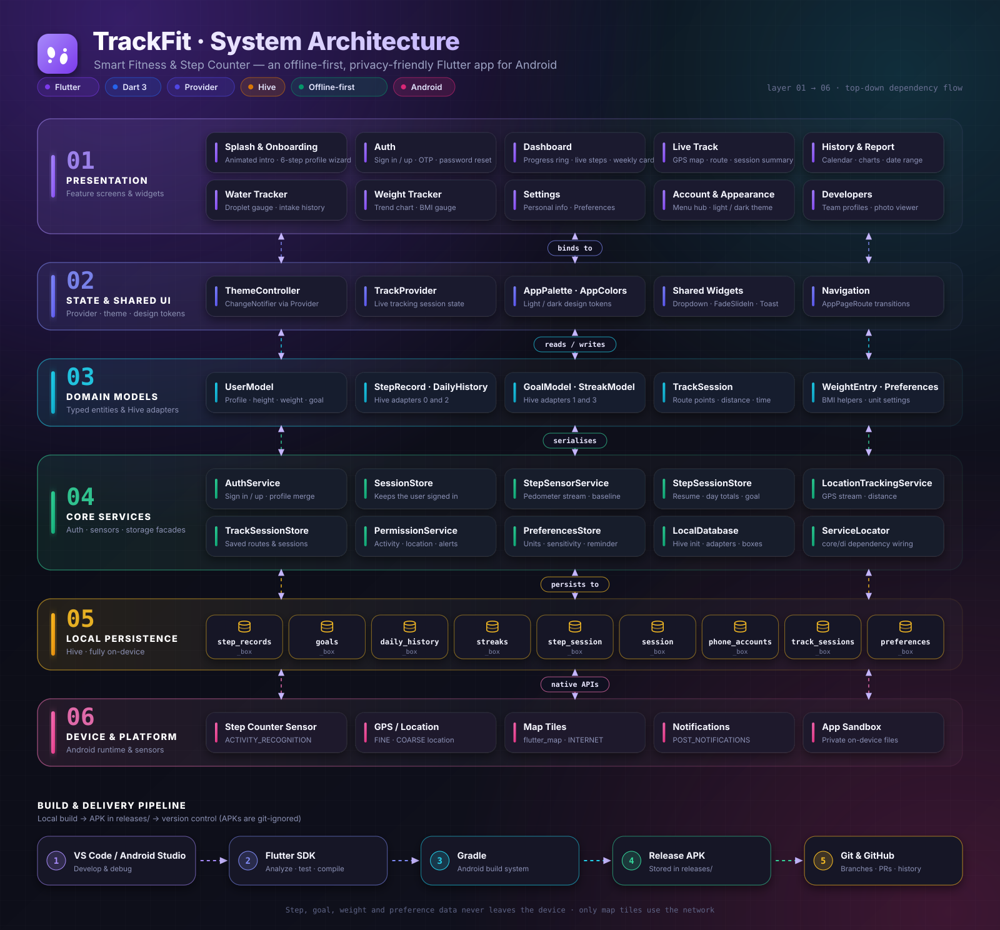
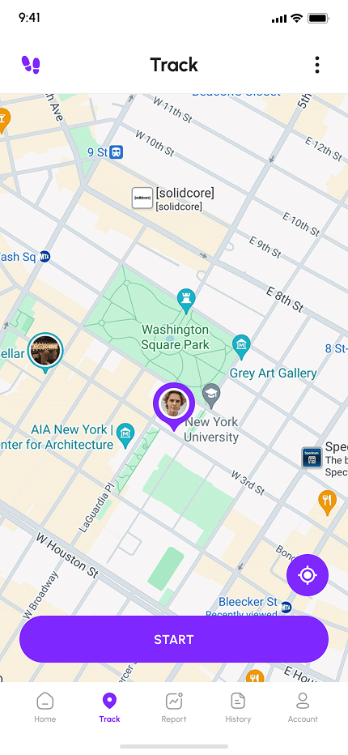

<div align="center">

# Step Counter & Walking Goals

A privacy-friendly Flutter application for Android that helps users track their daily physical activity and stay motivated toward a healthier lifestyle.

</div>

<div align="center">

### Team

|  |  |  |
| :----------------------------------------------------------------------------------------------------------------------------------------------------------: | :------------------------------------------------------------------------------------------------------------------------------------------------------: | :-------------------------------------------------------------------------------------------------------------------------------------------------------------: |
|                                                                      **Abdullah Rana**                                                                       |                                                                      **Ahmad Ali**                                                                       |                                                                      **Abdullah Qureshi**                                                                       |
|                                                                     Full Stack Engineer                                                                      |                                                                    Frontend Developer                                                                    |                                                                       Frontend Developer                                                                        |
|                                                                  `FullStack/Abdullah-Rana`                                                                   |                                                                   `FrontEnd/Ahmad-Ali`                                                                   |                                                                   `FrontEnd/Abdullah-Qureshi`                                                                   |

</div>

---

<div align="center">



<sub>Full-resolution diagram: <a href="architectures/step_counter_architecture.svg">SVG</a> · <a href="architectures/step_counter_architecture.png">PNG</a></sub>

</div>

## Overview

TrackFit is a privacy-friendly Flutter app for Android that counts your steps with the phone's built-in motion sensor, shows live progress toward a personal daily goal, and keeps a history of past days. Around that core sit live GPS tracking, a water tracker, a weight tracker with BMI, and a preferences hub, all in a polished light and dark UI.

There is no wearable and no manual logging. Steps, goals, history, weight and preferences are stored on the device. The only network use is loading map tiles for live tracking.

This project was built as a semester project for a Mobile Application Development course.

## Features

**Activity**
- Automatic step counting from the native step sensor, resumed after restarts and caught up after the app was closed
- Custom daily step goal with a live progress ring and a goal-completed celebration
- Weekly progress card and a streak model for consecutive goal days
- Live tracking: GPS route on a map, distance, time, and a session summary

**History & reports**
- Daily history, a progress calendar, statistics charts, and a date-range report

**Health trackers**
- **Water tracker:** animated droplet gauge with splash effect, quick-add sheet, goal dialog, and intake history chart
- **Weight tracker:** animated weight trend chart with a pin tooltip, range filter (3 / 6 / 12 months), add-weight sheet, and a BMI gauge with an editable height

**Account & settings**
- Onboarding wizard (gender, lifestyle, age, height, weight, step goal), sign in / sign up, OTP and password reset
- Personal Info with full create, read, update and delete
- **Preferences:** gender, age, height, weight, units (metric or imperial), step goal, sensitivity, step length, first day of week, and daily reminder with time
- Light and dark theme switching, developers page

## Tech Stack

| Area | Technology |
| :-- | :-- |
| Framework | **Flutter** (Dart SDK ^3.13.2) |
| State management | `provider` (`ChangeNotifier`) |
| Local storage | `hive` and `hive_flutter` |
| Sensors | `pedometer` (step counter), `geolocator` (GPS) |
| Maps | `flutter_map` and `latlong2` |
| Permissions | `permission_handler` |
| UI extras | `lucide_icons_flutter`, `curved_navigation_bar`, `confetti`, `loading_animation_widget`, `fluttertoast` |
| Platform | **Android** only (Kotlin `MainActivity`, Gradle) |
| Quality | `flutter_test`, `flutter_lints` |

## Architecture

The app is a layered, feature-first design. Each layer only talks to the layer directly beneath it, so UI, state, models, services and storage can be worked on in parallel.

| # | Layer | Responsibility |
| :-: | :-- | :-- |
| 01 | **Presentation** | One folder per feature under `lib/features/`, each with `presentation/screens` and `presentation/widgets`. |
| 02 | **State & shared UI** | `ThemeController` and `TrackProvider` via Provider, design tokens (`AppPalette`, `AppColors`), shared widgets, and page transitions. |
| 03 | **Domain models** | Typed entities (`UserModel`, step / goal / history / streak models, `TrackSession`, `WeightEntry`, `AppPreferences`) with Hive adapters for persisted ones. |
| 04 | **Core services** | `AuthService`, `SessionStore`, `StepSensorService`, `StepSessionStore`, `LocationTrackingService`, `TrackSessionStore`, `PermissionService`, `PreferencesStore`, `LocalDatabase`. |
| 05 | **Local persistence** | Hive boxes: `step_records`, `goals`, `daily_history`, `streaks`, `step_session`, `session`, `phone_accounts`, `track_sessions`, `preferences`. |
| 06 | **Device & platform** | Android step-counter sensor, GPS, map tiles, notifications and the app sandbox. |

The strip at the bottom of the diagram is the delivery pipeline: develop in VS Code or Android Studio, build with the Flutter SDK and Gradle, drop the APK into `releases/`, and track everything in Git and GitHub.

Notes on the current state:
- The water and weight trackers keep their entries in memory for now; persisting them is a natural next step.
- Sensitivity, step length, first day of week and reminder preferences are saved but not yet consumed by the step sensor, weekly card, or a notification scheduler.
- `core/di/ServiceLocator` is a placeholder for repository wiring.

Additional architecture diagrams are kept in [`architectures/`](architectures/).

## Design

Static exports of the UI/UX designs are kept in [`design/`](design/), organized by feature: Dashboard, History, Live Tracking, On-Boardings, Settings, FAQ, Water Remind, Weight Tracker and Preferences. They are reference snapshots only, not editable design source files.

### Screens

<div align="center">

|                                     Login                                     |                                   Sign Up                                    |                               Dashboard                               |
| :---------------------------------------------------------------------------: | :--------------------------------------------------------------------------: | :-------------------------------------------------------------------: |
|  |  |  |

|                              Water Level                               |                          Live Tracking                          |                              Weight Tracker                              |
| :--------------------------------------------------------------------: | :-------------------------------------------------------------: | :----------------------------------------------------------------------: |
|  |  |  |

|                                 Preferences                                 |
| :-------------------------------------------------------------------------: |
|  |

</div>

## Project Structure

```text
Fitness-App-Flutter/
├── architectures/                   # Architecture diagrams (SVG + PNG)
├── assets/                          # Icons, images, developer photos
├── design/                          # Reference UI/UX screens (not used in code)
├── lib/
│   ├── main.dart                    # Entry point, theme provider, routes
│   ├── core/
│   │   ├── config/  constants/      # App config, colors, asset paths
│   │   ├── di/                      # ServiceLocator
│   │   ├── navigation/              # AppPageRoute transitions
│   │   ├── services/                # LocalDatabase, step sensor, stores, permissions
│   │   ├── theme/                   # AppPalette, ThemeController, animations
│   │   └── utils/                   # AppToast
│   ├── widgets/                     # Shared widgets (animated dropdown, fade-slide-in)
│   └── features/                    # One folder per feature
│       ├── splash/  onboarding/  auth/
│       ├── dashboard/  home/        # Home tab, account tab, bottom nav
│       ├── track/                   # Live GPS tracking (data, domain, providers, UI)
│       ├── history/  goals/  streak/
│       ├── water_tracker/           # Droplet gauge, history chart, sheets
│       ├── weight_tracker/          # Weight chart, BMI gauge, sheets
│       ├── settings/                # Personal info, preferences (data + UI)
│       └── developers/  export/
├── test/                            # Widget and unit tests, mirrored per feature
├── releases/                        # Local APK builds (git-ignored)
└── pubspec.yaml
```

Features follow the same shape: `presentation/screens`, `presentation/widgets`, and `providers/`, plus `data/` and `domain/` where a feature owns its own data. Folders that only contain `.gitkeep` (`goals`, `streak`, `export` and parts of `history` and `settings`) are scaffolds for upcoming work.

## Getting Started

### Prerequisites

- Flutter SDK (^3.13.2 or later)
- Android Studio or VS Code with the Flutter/Dart plugins
- An Android device or emulator running Android 5.0 (API 21) or higher

### Setup

1. For the Cloning of the repository:
   ```
   git clone https://github.com/Abdullah-819/Fitness-App-Flutter.git
   ```
2. Navigate into the project directory:
   ```
   cd Fitness-App-Flutter
   ```
3. Install dependencies:
   ```
   flutter pub get
   ```
4. Run the application on a connected Android device or emulator:
   ```
   flutter run
   ```

## Team Collaboration

Each team member works on a dedicated branch aligned with their role (see the Team section above). Feature folders under `lib/features/` are structured so each contributor can work independently within their own `presentation/` and `providers/` subfolders without conflicting with the data layer. See [CONTRIBUTING.md](CONTRIBUTING.md) for the full branching and commit workflow.

## Release Builds

Locally built APKs can be placed in the `releases/` folder for quick access and sharing among the team. This folder is tracked in git, but `.apk`/`.aab` files inside it are excluded from version control to keep the repository lightweight. Each team member manages their own local builds in this folder.

## Platform Scope

This application targets Android exclusively. iOS, web, Windows, macOS, and Linux platform folders are intentionally not included, as this project is not intended for cross-platform distribution.

## Privacy

Step, goal, history, weight and preference data is stored locally on the device. The app has no backend and does not transmit that data to any server. The one network use is fetching map tiles for the Live Track screen.

## License

This project was developed for academic purposes as part of a Mobile Application Development course.
